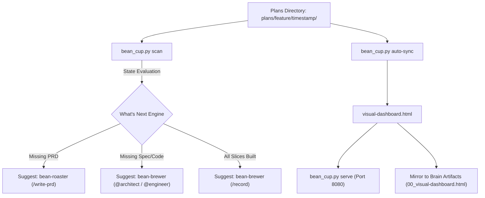

# 🍵 Bean-Cup

> Unified Visual Dashboard, Interactive Kanban Tracker, and Autonomous Workflow State Scanner for Antigravity SDLC pipelines.

---

## ☕ Why "The Cup"? (The Metaphor)

In specialty coffee brewing, the cup is the final, immaculate presentation layer. No matter what bean variety, roast profile, or extraction pressure was used, the cup is where clarity, color, aroma, and tasting notes are presented to the person enjoying the drink.

In our agentic swarm, **`bean-cup`** is that presentation layer:
- It does not brew code or roast requirements.
- It observes, scans, and renders the state of the entire software delivery lifecycle.
- It provides a single, unified lens (`visual-dashboard.html`) displaying ideation friction, ubiquitous glossaries, PRD requirements, technical contracts, task execution Kanbans, test verification results, and terminal walkthroughs.

---

## 🏛️ Origin & Architectural Rationale

### Spawned from `bean-to-cup`
**`bean-cup`** was extracted from the monolithic [`bean-to-cup`](https://github.com/sapientcoffee/bean-to-cup) repository as part of a modular decomposition of the Antigravity barista swarm.

### Why Decompose?
1. **Zero-Dependency Tracking:** Project managers, stakeholders, and developers who simply want to monitor progress or inspect deliverables should not need to install heavy code generation tools, test runners, or SRE dependencies.
2. **Universal Plan Scanning:** By decoupling the dashboard and state engine, `bean-cup` can dynamically scan, evaluate, and visualize **any** plan directory produced by any toolchain or agent swarm.
3. **Independent UI Evolution:** Visual dashboard components, CSS themes, and Kanban layouts can be modernized and enhanced without risking regressions in code generation or PR workflows.
4. **Decoupled Markdown Handoffs:** All communication across the swarm happens through standardized, version-controlled markdown files (`00_IDEATION.md` through `08_WALKTHROUGH.md`). `bean-cup` is the visual consumer of this contract.

---

## 🚀 Capabilities & Key Aspects

| Feature | Description |
| :--- | :--- |
| **Dynamic State Scanner** | Inspects any `./plans/` directory, checks artifact presence across Stages 0–8, parses markdown checkboxes in `05_PLAN.md`, calculates completion metrics, and determines the exact **"What's Next"** step and suggested command. |
| **Unified Master Dashboard** | A self-contained, responsive single-page HTML dashboard (`visual-dashboard.html`) containing 7 integrated stage tabs: Discovery, Glossary, PRD, Technical Spec, Interactive Kanban, Test Verification, and Walkthrough. |
| **Standalone Dashboard Server** | Built-in zero-dependency Python HTTP server (`bean_cup.py serve`) serving the live dashboard locally with hot-reloading asset support. |
| **Artifact Dual-Write Guarantee** | Automatically mirrors generated dashboards to the Antigravity UI Artifacts viewer (`00_visual-dashboard.html`), enabling real-time previewing directly inside the chat interface without leaving the IDE. |
| **Interactive Kanban Board** | Markdown & HTML Kanban visualization with bidirectional task status tracking (`[ ] Pending`, `[/] In Progress`, `[x] Completed`). |

---

## 🔄 End-to-End Workflow



---

## 🛠️ CLI Usage & Commands

```bash
# 1. Dynamically scan any plan directory to compute stage progress and "What's Next"
python3 bean_cup.py scan --plan-dir plans/my-feature/2026-08-11_1230

# 2. Output raw JSON for machine integration or CI/CD pipelines
python3 bean_cup.py scan --plan-dir plans/my-feature/2026-08-11_1230 --json

# 3. Serve the interactive dashboard locally on port 8080 (or custom port)
python3 bean_cup.py serve --plan-dir plans/my-feature/2026-08-11_1230 --port 8080

# 4. Ingest and synchronize all markdown stage files into the master visual-dashboard.html
python3 bean_cup.py auto-sync --plan-dir plans/my-feature/2026-08-11_1230 --moniker my-feature
```

---

## 📦 Installation

```bash
# Install to local Antigravity plugin registry
./install.sh

# Or install via agy CLI
agy plugin install .
```

---

## 📜 License
Apache-2.0 - Copyright 2026 Google LLC.
